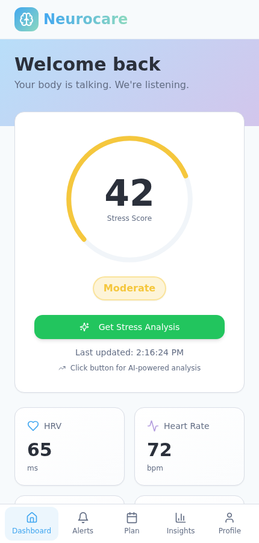
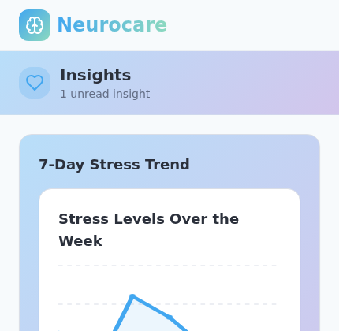
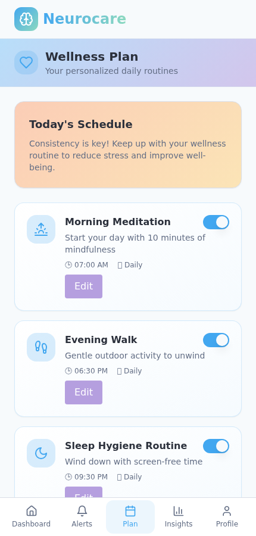
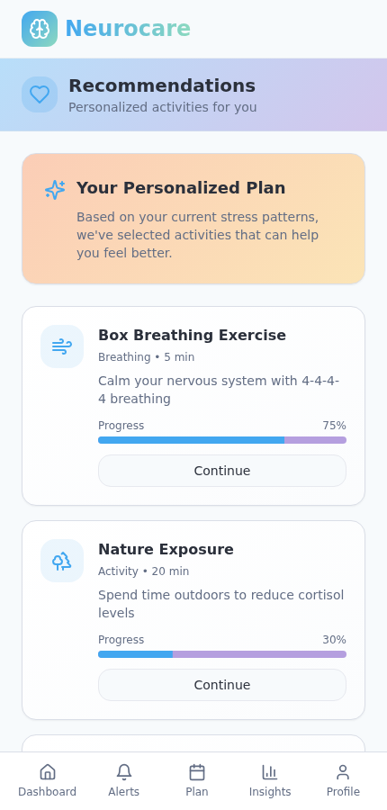
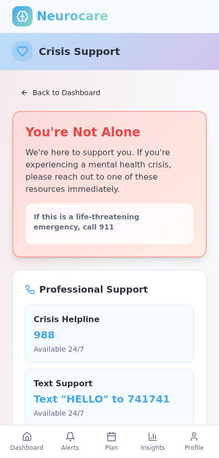

# CardioCare (Neurocare)

Stress monitoring and wellness app. It takes seven days of physiological data (HRV, heart rate, breathing rate, EDA, skin temperature, steps, active minutes, sleep), predicts a stress score with a BiLSTM + attention + CNN model, and turns it into an explanation, a recommendation and a daily wellness plan.

## Publication

Presented at **AICTE IC-AISMART 2025**.

- [Paper](https://drive.google.com/file/d/1rtIyLkhXJknbG6IZ3xnvYhAdfZMtekmR/view?usp=sharing)
- [Certificate](https://drive.google.com/file/d/1gIixv8__F7TiX_gNnTqxBhzfHkMsGMrs/view?usp=sharing)

## Screenshots

Captured from the running frontend (mobile viewport). The dashboard shows the app's default values until you run a stress analysis against the backend.

| Dashboard | Insights | Wellness Plan |
|---|---|---|
|  |  |  |

| Recommendations | Crisis Support |
|---|---|
|  |  |

## Features

- **Stress score**: gauge with a status badge (e.g. Moderate), plus HRV and heart rate cards. "Get Stress Analysis" sends the last 7 days to the model.
- **AI explanation and recommendation**: the backend asks an LLM (via OpenRouter) for a short explanation and a suggestion based on the score and latest vitals.
- **Alerts**: each analysis is saved as a notification, newest first, with read/unread state.
- **Insights**: 7-day stress trend and major stress reasons.
- **Wellness plan**: editable daily routines with toggles.
- **Recommendations**: activities such as box breathing, with progress tracking.
- **Crisis support**: helpline resources in one tap.
- **Auth**: sign-in and sign-up through Clerk.

## How it works

```
React app (Vite)  --POST /predict-->  FastAPI (:8000)
                                              |- scaler (neurocare_scaler.pkl)
                                              |- model  (neurocare_stress_model.h5)
                                              '- OpenRouter LLM -> explanation + recommendation
```

**Model** (`Neurocare_lstm_cnn.ipynb`): 7-day input window, Bidirectional LSTM (64) -> self-attention -> LayerNorm -> Conv1D (32) -> global max pooling -> Dense (64) -> Dropout (0.25) -> Dense (1) regression output.

**Data**: `heart_dataset.csv` (raw) and `cleaned_dataset.csv` (after `cleaning.ipynb`), with columns HRV, HR, BreathingRate, EDA, SkinTemp, Steps, ActiveMinutes, SleepHours, SleepInterruptions and StressScore.

## API

| Method | Route | Purpose |
|---|---|---|
| POST | `/predict` | Score the last 7 days, return score, explanation, recommendation, and save an alert |
| POST | `/mock-stress-analysis` | Canned analysis without the model |
| GET | `/notifications` | List alerts |
| POST | `/notifications` | Add an alert |
| PATCH | `/notifications/{id}/read` | Mark an alert read |
| DELETE | `/notifications/{id}` | Delete an alert |

## Tech stack

- **Frontend**: React, TypeScript, Vite, Tailwind CSS, shadcn/ui, Recharts, Clerk
- **Backend**: Python, FastAPI, Uvicorn
- **ML**: TensorFlow/Keras, scikit-learn scaler, pandas, NumPy

## Project structure

```
app/                     React frontend (src/pages, src/components, src/contexts, src/lib/api.ts)
app.py                   FastAPI backend
auth.py                  mock Google OAuth + dataset API
neurocare_stress_model.h5   trained model
neurocare_scaler.pkl        fitted scaler
Neurocare_lstm_cnn.ipynb    model training
cleaning.ipynb              data cleaning
heart_dataset.csv, cleaned_dataset.csv
docs/screenshots/        README screenshots
```

## Getting started

**Prerequisites**: Node.js 18+, Python 3.8+.

1. Clone

   ```bash
   git clone https://github.com/rajarshidattapy/cardiocare.git
   cd cardiocare
   ```

2. Backend

   ```bash
   pip install fastapi uvicorn tensorflow numpy pandas scikit-learn requests
   export OPENROUTER_API_KEY=your_key   # needed for the AI explanation
   python app.py                        # serves on http://localhost:8000
   ```

3. Frontend

   ```bash
   cd app
   npm install
   echo "VITE_CLERK_PUBLISHABLE_KEY=your_clerk_key" > .env
   npm run dev -- --port 3000            # backend CORS allows :3000 and :5173
   ```

## Contributing

Fork the repo, create a branch, and open a pull request with a clear description.
